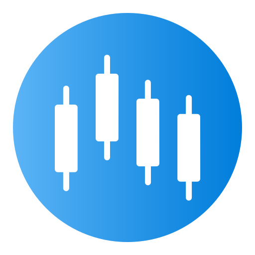
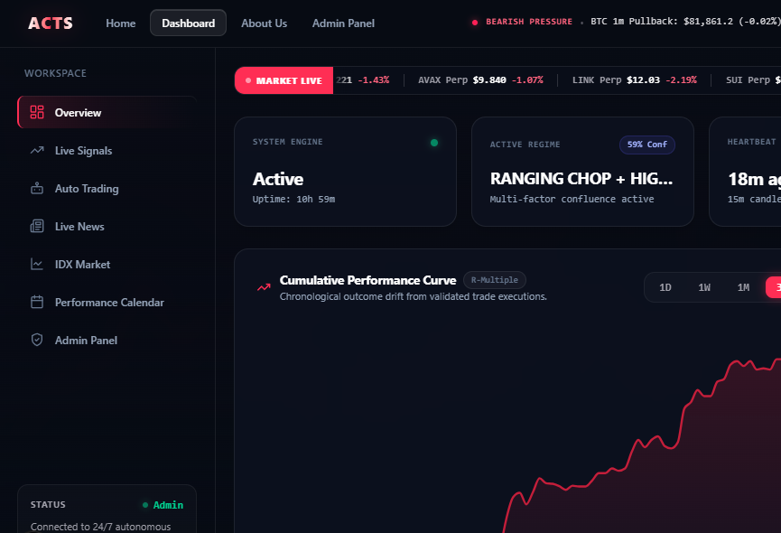
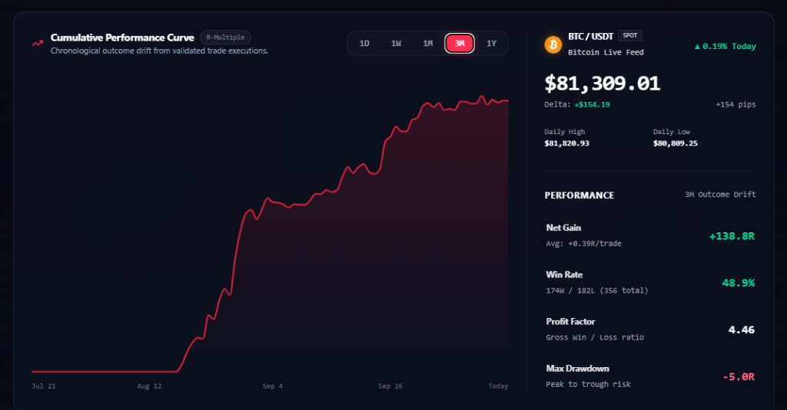
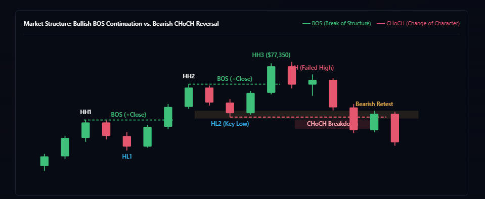
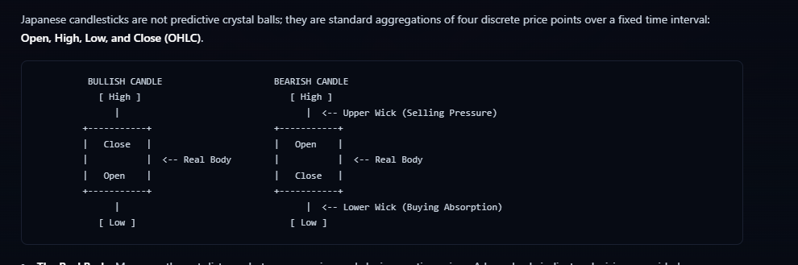

<div align="center">



# ACTS — Autonomous Crypto & Equities Trading System
### Institutional Quantitative Terminal, Real-Time Signal Intelligence & Interactive Trading Academy

[](https://nextjs.org/)
[](https://react.dev/)
[](https://www.typescriptlang.org/)
[](https://tailwindcss.com/)
[](https://www.tradingview.com/lightweight-charts/)
[](https://supabase.com/)

<p align="center">
  <a href="#-web-design--interface-showcase"><b>📸 UI Showcase</b></a> •
  <a href="#-interactive-feature-explorer"><b>⚡ Interactive Explorer</b></a> •
  <a href="#-system-architecture-flow"><b>🧠 Architecture</b></a> •
  <a href="#-application-route-map"><b>🗺️ Route Map</b></a> •
  <a href="#-quick-start--local-development"><b>🚀 Quick Start</b></a>
</p>

</div>

---

## 📸 Web Design & Interface Showcase

### 1. Autonomous Trading Workspace & Live Market Terminal (`/dashboard`)
> Persistent workspace sidebar with real-time `15m` / `4H` engine heartbeat, active regime classification (`TRENDING_BULLISH`, `TRENDING_BEARISH`, `RANGING_CHOP`, `HIGH_VOLATILITY`), live multi-asset ticker tape, and orderflow telemetry.

<p align="center">
  
</p>

### 2. Cumulative R-Multiple Performance Curve & Outcome Drift
> Tracks verified closed-loop trade outcomes in true weighted `R-multiples` (`TP1 = 40% @ 1.0R`, `TP2 = 35% @ 2.0R`, `TP3 = 25% @ 3.5R`, `SL = -1.0R`) alongside live BTC/USDT spot feed, win rate, profit factor, and maximum drawdown.

<p align="center">
  
</p>

### 3. Interactive Quantitative Trading Academy (`/dashboard/academy`)
> Built-in interactive candlestick/market-structure visualizers (`BOS` vs `CHoCH`) and structured quantitative curriculum modules.

| Interactive Market Structure (`BOS` / `CHoCH`) | OHLC Candlestick Mechanics & Orderflow |
| :---: | :---: |
|  |  |

---

## ⚡ Interactive Feature Explorer

*Click any module below to expand its technical specifications and UI capabilities:*

<details open>
<summary><b>📊 1. Live Signal & Watchlist Intelligence (<code>/dashboard/signals</code>)</b></summary>
<br />

- **9-Factor Confluence Breakdown**: Displays individual factor contributions (`EMA Trend Alignment`, `4H HTF Bias`, `Stochastic Trigger`, `Stochastic Divergence`, `Multi-Touch Support/Resistance`, `Volume Expansion`, `Candlestick ATR Confirmation`, `Market Structure BOS/CHoCH`, and `Gemini AI Macro Sentiment`).
- **Dual-Tier Outcome Tracking (`SIGNAL` vs `WATCHLIST`)**:
  - **`SIGNAL` Tier**: High-conviction setups clearing the regime-adjusted threshold (`52.0` base; `67.0` in `RANGING_CHOP`), verified by the Pre-Trade Confirmation Council and tracked in the `$10,000` paper account and `TradeJournal`.
  - **`WATCHLIST` Tier**: Sub-threshold (`45.0+` pts) setups monitored in real time for `TP1` / `TP2` / `TP3` / `SL` milestone hits across Web and Telegram without polluting closed-loop equity metrics.
- **Multi-Tier Progress Bar**: Live visual progression from `Entry` → `TP1 (1.0R, SL to Breakeven)` → `TP2 (2.0R, Trailing Stop)` → `TP3 (3.5R)`.

</details>

<details>
<summary><b>🛡️ 2. Pre-Trade Confirmation Council & Self-Learning Loop</b></summary>
<br />

- **Orthogonal Multi-Agent Veto & Sizing Gate**:
  1. **Microstructure Agent**: Evaluates L2 orderbook imbalance, bid-ask spread illiquidity, and 8-hour perpetual funding crowding.
  2. **Adversarial Critic Agent**: Synthesizes bull vs. bear cases, identifies structural traps, and flags missing core confluence factors.
  3. **Macro & Risk Gatekeeper**: Enforces daily/weekly drawdown circuit breakers and high-impact FOMC/CPI event protection.
- **Verdict Scaling**: Outputs `CONFIRMED (1.0x)`, `CAUTION_HALF_SIZE (0.5x)`, or `VETO (0.0x)`—never artificially inflating technical confluence scores.

</details>

<details>
<summary><b>🇮🇩 3. IDX (Indonesian Stock Exchange) Equities Suite (<code>/dashboard/idx/*</code>)</b></summary>
<br />

- **IDX Market Overview (`/dashboard/idx`)**: Composite IHSG telemetry, top gainers/losers, and institutional flow tracking.
- **L2 Orderbook & Broker Summary (`/dashboard/idx/orderbook`)**: Real-time bid/ask depth and lot distribution analysis.
- **Fundamental Key Stats (`/dashboard/idx/keystats`)**: Valuation ratios (`PER`, `PBV`, `ROE`, `DER`, dividend yield) and quarterly earnings trends.
- **Corporate Actions & Watchlist (`/dashboard/idx/corporate-actions`, `/dashboard/idx/watchlist`)**: Dividend schedules, stock splits, rights issues, and custom ticker monitoring.

</details>

<details>
<summary><b>🎓 4. Quantitative Trading Academy (<code>/dashboard/academy</code>)</b></summary>
<br />

- **Structured Multi-Track Curriculum**: Covers OHLC market mechanics, multi-timeframe EMA structure, support/resistance zone validation, stochastic momentum divergences, and R-multiple risk mathematics.
- **Interactive SVG Charts & Quizzes**: Lesson modules feature custom SVG price-action diagrams, statutory risk disclosures, and end-of-lesson mastery checks persisted per user profile.

</details>

<details>
<summary><b>🤖 5. Autonomous Binance Futures Execution Bridge (<code>/dashboard/auto-trading</code>)</b></summary>
<br />

- **Testnet & Mainnet Bridge**: Connects user API keys with isolated margin and bracketed `STOP_MARKET` + `TAKE_PROFIT_MARKET` orders (`TP1` / `TP2` / `TP3`).
- **Option-A Active Trade Preservation**: Automatically preserves active same-direction positions without redundant re-entry churn.

</details>

---

## 🧠 System Architecture Flow

```mermaid
flowchart LR
    subgraph Market["📡 Live Market Feeds"]
        B["Binance 15m / 4H Candles"]
        O["L2 Orderbook & Funding"]
        N["Macro News & Fed Calendar"]
    end

    subgraph Brain["⚙️ ACTS Quantitative Engine"]
        R["Regime Engine\n(Schmitt-Trigger Hysteresis)"]
        C["9-Factor Confluence Scorer\n(Pullback & ATR Guards)"]
        M["Pre-Trade Confirmation Council\n(1.0x / 0.5x / VETO)"]
        T["Outcome Tracker & Learning Loop\n(TP1 / TP2 / TP3 / SL)"]
    end

    subgraph Edge["☁️ Supabase & Realtime API"]
        E["Edge Functions\n(get-signals / get-performance / notify-poller)"]
    end

    subgraph Web["🖥️ ACTS-Web (Next.js 16 + React 19)"]
        D["Live Dashboard & Equity Curve"]
        S["Signal & Watchlist Tracker"]
        I["IDX Equities Terminal"]
        A["Interactive Trading Academy"]
    end

    Market --> Brain
    R --> C --> M --> T
    T --> Edge --> Web
```



---

## 🗺️ Application Route Map

| Route | Module | Description |
| :--- | :--- | :--- |
| `/` | **Landing Page** | Live multi-asset ticker tape, interactive `BTC`/`ETH`/`SOL` regime preview, and feature showcase |
| `/about` | **Architecture & About** | Deep-dive into the 9-factor confluence model, risk invariants, and system philosophy |
| `/login` | **Authentication** | Firebase Auth sign-in/registration with role and rules gating |
| `/dashboard` | **Terminal Overview** | System heartbeat, active regime badge, cumulative `R-multiple` performance curve, and latest setup |
| `/dashboard/signals` | **Live Signals & Watchlist** | Full feed of `SIGNAL` and `WATCHLIST` setups with real-time `TP1`/`TP2`/`TP3`/`SL` hit status |
| `/dashboard/auto-trading` | **Auto-Trading Bridge** | Automated Binance Futures execution status, active bracket orders, and execution log |
| `/dashboard/news` | **AI Macro Intelligence** | Real-time crypto/macro news feed scored by Gemini AI sentiment analysis |
| `/dashboard/calendar` | **Economic Calendar** | Upcoming FOMC, CPI, NFP, and high-impact macro releases with countdown timers |
| `/dashboard/academy` | **Trading Academy** | Multi-track quantitative trading curriculum with interactive charts and progress tracking |
| `/dashboard/idx` | **IDX Equities Terminal** | Indonesian Stock Exchange (`IHSG`) dashboard, orderbook, keystats, and corporate actions |

---

## 🚀 Quick Start & Local Development

### 1. Clone & Install Dependencies

```bash
git clone https://github.com/BimaSatyaM/ACTS-Web.git
cd ACTS-Web
npm install
```

### 2. Configure Environment Variables

Copy `.env.example` to `.env.local` and populate your public endpoints:

```bash
cp .env.example .env.local
```

```env
NEXT_PUBLIC_SUPABASE_URL=https://your-project.supabase.co
NEXT_PUBLIC_SUPABASE_ANON_KEY=your-public-anon-key
NEXT_PUBLIC_FIREBASE_API_KEY=your-firebase-api-key
NEXT_PUBLIC_FIREBASE_AUTH_DOMAIN=your-project.firebaseapp.com
NEXT_PUBLIC_FIREBASE_PROJECT_ID=your-project-id
```

### 3. Run the Development Server

```bash
npm run dev
```

Open [http://localhost:3000](http://localhost:3000) in your browser.

---

<div align="center">
  
  <br />
  <sub>Built with Next.js 16, React 19, Tailwind CSS 4, and TradingView Lightweight Charts.</sub>
</div>
